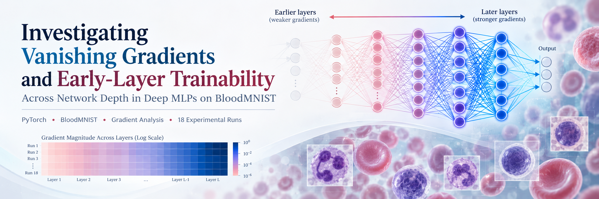

---
title: "The Effects of Vanishing Gradients in Deep Neural Networks"
layout: single
author_profile: true
--- 

<!--
<p align="center">
  
</p>
-->  

<p align="center">
  
</p>


# Investigating Vanishing Gradients and Early-Layer Trainability Across Network Depth in Deep MLPs on BloodMNIST

**A controlled empirical study of gradient attenuation, early-layer trainability, and optimization dynamics in deep multilayer perceptrons.**

**PyTorch · BloodMNIST / MedMNIST v2 · Neural Network Optimization · Reproducible Experiments**

[Project website](https://uyentran9.github.io/gradient-vanishing/) · [Experimental pipeline](https://uyentran9.github.io/gradient-vanishing/pipeline/) · [Jupyter notebook](files/gradient_vanishing_bloodmnist_uyentran_v4.ipynb) · [Executed notebook (HTML)](https://uyentran9.github.io/gradient-vanishing/files/gradient_vanishing_bloodmnist_uyentran_v4.html) · [Technical report (PDF)](files/gradient_vanishing_technical_report_uyentran.pdf)

## Overview

Vanishing gradients can make deep neural networks difficult to optimize when the weight gradients reaching earlier layers become extremely small. This project investigates how **network depth** and **hidden-layer activation functions** are associated with gradient attenuation, parameter movement, and learning progress in multilayer perceptrons (MLPs) trained on **BloodMNIST** dataset.

The primary objective is **to characterize neural-network optimization behavior**, not to maximize blood-cell classification accuracy or develop a clinical diagnostic model. The study combines controlled experimental comparisons with layer-wise gradient measurements, training trajectories, validation metrics, and explicit analysis of the limits of the evidence.

## Research Questions and Hypotheses

**RQ1 — Network depth.** How does increasing network depth affect layer-wise weight-gradient magnitudes and the trainability of early layers in Sigmoid MLPs on BloodMNIST?

**RQ2 — Activation functions.** Under a common initialization and training protocol, how do Sigmoid, Tanh, and ReLU differ in relative gradient attenuation, optimization progress, and classification performance at a fixed network depth?

The experiments investigate three hypotheses:

- **H1 — Depth effect:** Increasing depth is expected to produce stronger early-layer RMS weight-gradient attenuation relative to later hidden layers under susceptible training conditions.
- **H2 — Early-layer trainability effect:** Stronger attenuation is expected to coincide with smaller normalized first-layer weight displacement and slower optimization progress.
- **H3 — Activation effect:** Gradient attenuation and trainability may differ across Sigmoid, Tanh, and ReLU; the original hypothesis also allows for interactions with depth and initialization, which are not fully tested in this study.

## Experimental Design

The implementation uses a configurable, constant-width MLP with **256 units in every hidden layer**:

```text
BloodMNIST RGB image (3 × 28 × 28)
                ↓
          Flatten (2,352)
                ↓
   D hidden Linear layers (256 units each)
   + one shared activation type per model
                ↓
          Linear output (8 logits)
                ↓
        Cross-entropy loss
```

Here, **D counts hidden layers only**, excluding the output layer. The model has no convolutional layers, dropout, batch normalization, or residual connections.

| Stage | Experimental factor | Configurations | Primary purpose |
|---|---|---|---|
| **A — Network depth** | Hidden-layer count | D2, D5, D10, D20; all Sigmoid | Examine depth-dependent gradient attenuation and early-layer trainability |
| **B — Activation function** | Hidden-layer nonlinearity | Sigmoid, Tanh, ReLU; all D5 | Compare gradient and optimization behavior at fixed depth |

**Shared main-experiment protocol:**

| Setting | Value |
|---|---|
| Dataset | BloodMNIST (MedMNIST v2), official train/validation/test splits |
| Initialization | Xavier Uniform (gain = 1) for all Linear weights; zero biases |
| Optimizer | Plain SGD, momentum = 0, weight decay = 0 |
| Learning rate | 0.1, fixed across main configurations |
| Loss | Multiclass cross-entropy |
| Training duration | 20 epochs per run |
| Mini-batch size | 128 for training; 1,024 for validation/test |
| Random seeds | 0, 1, 2 |
| Replication | **18 unique main training runs** |

Stage A contributes **4 depths × 3 seeds = 12 runs**. Stage B has **3 activations × 3 seeds = 9 condition–seed entries**, but the three D5–Sigmoid runs are **reused from Stage A**, giving **18 unique runs**, excluding preliminary tests and pilots.

A preliminary **three-epoch learning-rate sanity pilot** compared D2 and D20 at seed 0. With no obvious numerical instability at learning rate 0.1, that rate was retained. A training-loss threshold of **1.50** was selected using the pilot trajectories and frozen before the main experiments; it measures **progress within the 20-epoch budget**, not mathematical convergence.

## Dataset and Preprocessing

[BloodMNIST](https://medmnist.com/) comprises **17,092** microscopic peripheral blood-cell images across **eight classes**, each represented as a **28 × 28 RGB** image. The official partitions were used without further splitting or augmentation:

| Partition | Images | Role |
|---|---:|---|
| Training | 11,959 | Parameter optimization and training-time gradient recording |
| Validation | 1,712 | Epoch-level loss, accuracy, and macro-F1 evaluation |
| Test | 3,421 | Dataset verification only; **no test-set classification results are reported** |

Images are converted to tensors and normalized using **per-channel mean and standard deviation calculated from the training split only**. The same statistics are applied to all partitions. Images are flattened **inside the MLP**, not during dataset loading. Training batches are shuffled with a seed-controlled PyTorch generator; validation and test batches are not shuffled.

The dataset is retrieved through the `medmnist` package and is **not redistributed** in this repository. See the [Dataset page](https://uyentran9.github.io/gradient-vanishing/dataset/) for provenance and access instructions.

## Measurements and Evaluation

To study gradient attenuation together with trainability, the notebook records:

1. **Layer-wise RMS weight gradients.** For each hidden Linear layer, the root-mean-square magnitude of the weight-gradient tensor, recorded after backpropagation and before the SGD update. Output-layer and bias gradients are not included in this layer-wise analysis.
2. **First-to-last hidden-layer gradient ratio.** The RMS gradient at Hidden Layer 1 divided by the RMS gradient at the last hidden layer, calculated per seed and summarized across seeds. The principal depth comparison uses **epoch 1**.
3. **Normalized first-layer weight displacement.** The Frobenius norm of the difference between the current and initially stored first-layer weights, divided by the norm of the initial weights. This is **net displacement**, not the cumulative sum of individual parameter updates.
4. **Optimization progress.** Sample-weighted training cross-entropy trajectories and the first epoch reaching the predefined training-loss threshold of 1.50, if reached within 20 epochs.
5. **Validation performance.** Cross-entropy loss, accuracy, and macro-F1 evaluated after each epoch.

The gradient recorder captures the **first 100 global training steps** and the **first 10 mini-batches of each epoch**. Epoch-level gradient magnitudes are averages of the recorded mini-batch RMS values. Run-level results are reported as **mean ± sample standard deviation over three seeds**, where defined.

## Results

### Stage A — Network Depth (Sigmoid)

| Depth | First-to-last RMS gradient ratio, epoch 1 | First-layer displacement, epoch 20 | Training loss, epoch 20 | Validation accuracy, epoch 20 |
|---|---:|---:|---:|---:|
| **D2** | 0.4070 | 0.3279 | 0.3963 | 0.8123 |
| **D5** | 0.006369 | 0.1090 | 1.2555 | 0.4663 |
| **D10** | 4.837 × 10⁻⁶ | 2.740 × 10⁻⁵ | 2.0114 | 0.1820 |
| **D20** | 2.711 × 10⁻¹² | 0.0000* | 2.0117 | 0.1820 |

*Values are means across three seeds; sample standard deviations and macro-F1 results are given in Table 1A of the technical report. The D20 displacement of 0.0000 was recorded at the available numerical precision and does **not** establish that the underlying mathematical updates were exactly zero.*

The first-to-last hidden-layer RMS gradient ratio decreased markedly as Sigmoid MLP depth increased. Smaller early-layer gradients were accompanied by smaller recorded first-layer displacement and slower training-loss reduction. All D2 runs reached the predefined loss threshold at epoch 2; D5 runs reached it at epochs 14–15; D10 and D20 did **not** reach it within 20 epochs.

### Stage B — Activation Functions (D5)

| Activation | First-to-last RMS gradient ratio, epoch 1 | First-layer displacement, epoch 20 | Validation accuracy, epoch 20 | Validation macro-F1, epoch 20 |
|---|---:|---:|---:|---:|
| **Sigmoid** | 0.006369 | 0.1090 | 0.4663 | 0.3377 |
| **Tanh** | 0.4750 | 0.3981 | **0.8621** | **0.8441** |
| **ReLU** | 0.4954 | 0.4033 | 0.8170 | 0.7946 |

*Values are means across three seeds; full sample standard deviations, training losses, and loss-threshold results are reported in Table 1B of the technical report. The D5–Sigmoid measurements are reused from Stage A.*

At fixed D5 depth, Tanh and ReLU exhibited substantially less relative early-layer weight-gradient attenuation and faster observed optimization than Sigmoid under the shared Xavier–SGD protocol. **Tanh achieved the highest mean validation accuracy and macro-F1**, whereas **ReLU had the slightly larger mean relative gradient ratio**. These descriptive results do not establish a statistically reliable ranking between Tanh and ReLU or the superiority of either activation across other depths or initialization schemes.

### Principal Figures

The [technical report](files/gradient_vanishing_technical_report_uyentran.pdf) presents three primary figures:

- **Figure 1:** Hidden-layer RMS weight-gradient magnitudes and relative gradients versus layer position for D2, D5, D10, and D20.
- **Figure 2:** D20 layer-by-epoch heatmap showing persistent gradient attenuation over 20 training epochs.
- **Figure 3:** Training-loss trajectories across depths with the predefined loss threshold of 1.50.

## Interpretation and Limitations

**H1 is supported** within the tested Sigmoid–Xavier–SGD setting. **H2 is supported as an empirical association** between relative gradient attenuation, smaller net first-layer displacement, and slower optimization; the design does not establish vanishing gradients as the sole causal mechanism. **H3 is partially supported:** substantial activation-dependent differences were observed at D5, but interactions with depth and initialization were not tested.

Important limitations include:

- **Measurement scope:** RMS **weight gradients** are not direct measurements of activation-gradient propagation, activation saturation, or network Jacobian properties.
- **Architectural scope:** The study uses one dataset and constant-width, fully connected MLPs; parameter count nevertheless increases with depth.
- **Experimental scope:** Stage B evaluates activations only at D5 and uses one common initialization rule, which is not necessarily optimal for ReLU.
- **Statistical scope:** Three random seeds, one fixed learning rate, and no formal hypothesis-significance tests or confidence intervals.
- **Evaluation scope:** Classification results are validation metrics, **not independent test-set performance estimates**. The study does not establish clinical utility.

Potential extensions include activation-by-depth experiments, activation-specific initialization, direct saturation diagnostics, residual connections and normalization, optimizer sensitivity, and a CNN extension. **These are future directions, not completed experiments.**

## Reproducibility

### Requirements

The final recorded experiments used **Python 3.13**, **PyTorch 2.14.1**, **MedMNIST 3.0.2**, and an Apple Silicon **MPS** backend. The implementation selects CPU when MPS is unavailable. Differences in hardware backends and dependency versions can affect floating-point results.

```bash
# Clone the repository
git clone https://github.com/uyentran9/gradient-vanishing.git
cd gradient-vanishing

# Create and activate a Python environment
python3 -m venv .venv
source .venv/bin/activate

# Install the documented dependencies
python -m pip install -r requirements.txt
```

Open the [source notebook](files/gradient_vanishing_bloodmnist_uyentran_v4.ipynb) in VS Code or Jupyter and execute its cells **from Part 0 through Part 8**, in order, with a fresh kernel. The `medmnist` package downloads BloodMNIST as needed; the notebook uses relative directories **`./data`** for data and **`./results`** for outputs. A full reproduction includes the pilot, all 18 unique main training runs, recorded gradient measurements, and final verification checks.

| Notebook part | Purpose |
|---|---|
| Part 0 | Setup and library imports |
| Part 1 | Data pipeline, training-only normalization, official splits, configuration |
| Part 2 | Configurable MLP architecture, initialization, model checks |
| Part 3 | SGD training and validation pipeline |
| Part 4 | Gradient recording and weight-displacement measurements |
| Part 5 | Pipeline verification and learning-rate/loss-threshold pilot |
| Part 6 | Stage A: depth comparison and Figures 1–3 |
| Part 7 | Stage B: fixed-depth activation comparison |
| Part 8 | Final experiment verification and scientific reporting |

The [executed HTML notebook](https://uyentran9.github.io/gradient-vanishing/files/gradient_vanishing_bloodmnist_uyentran_v4.html) preserves saved outputs for inspection without retraining. For research reproduction, use the executable `.ipynb` source rather than the HTML export.

## Research Materials

| Resource | Description |
|---|---|
| [Project website](https://uyentran9.github.io/gradient-vanishing/) | Study overview and navigation |
| [Experimental Design and Pipeline](https://uyentran9.github.io/gradient-vanishing/pipeline/) | Detailed experimental protocol, implementation decisions, and measurement definitions |
| [Dataset](https://uyentran9.github.io/gradient-vanishing/dataset/) | BloodMNIST source, official partitions, and preprocessing |
| [Executable Jupyter notebook](files/gradient_vanishing_bloodmnist_uyentran_v4.ipynb) | PyTorch implementation, code, recorded results |
| [Notebook HTML preview](https://uyentran9.github.io/gradient-vanishing/code/) | Browser-readable executed notebook |
| [Technical report (PDF)](files/gradient_vanishing_technical_report_uyentran.pdf) | Research background, methods, full tables, three figures, discussion, and references |

## References and Attribution

This project draws on the literature on gradient propagation and initialization, particularly **Bengio et al. (1994)**, **Glorot and Bengio (2010)**, **Schoenholz et al. (2017)**, and **He et al. (2015)**. Dataset provenance is provided by **Acevedo et al. (2020)** and the **MedMNIST v2** benchmark (**Yang et al., 2023**). Full bibliographic references appear in the technical report.

**Author:** Victoria Tran (Uyen Tran) · Research project  
**Research-use notice:** BloodMNIST is an educational and research benchmark. This study is not a clinically validated diagnostic system and should not be used for medical decision-making.

